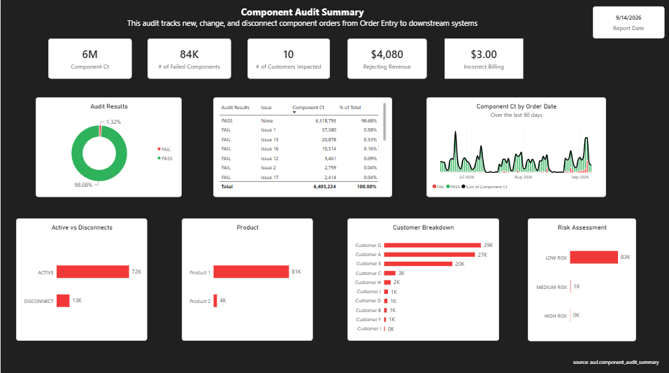
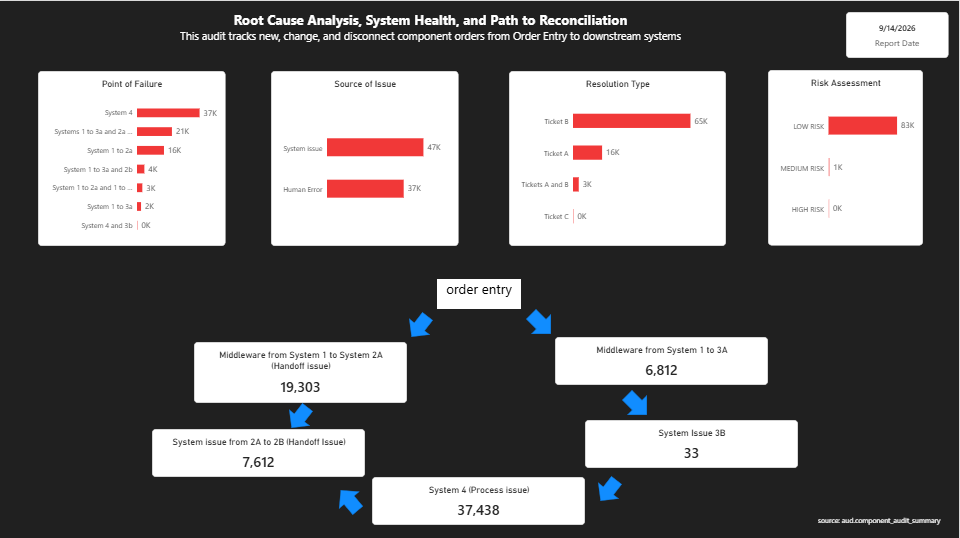

# Telecom Component Audit Framework

[](https://kristin-mooney.github.io/telecom-component-audit-framework/)
[](https://kristin-mooney.github.io/telecom-component-audit-framework/)

An automated telecommunications component audit framework built using SQL Server and Power BI. The solution reconciles component orders across multiple downstream systems, identifies failures throughout the order lifecycle, determines root causes, quantifies customer and revenue impact, and prioritizes remediation through automated reporting — transforming a previously manual process into a scalable monitoring solution capable of validating millions of component records.

---

## [View Full Project Write-Up](https://kristin-mooney.github.io/telecom-component-audit-framework/)

---

## Dashboard Overview

### Dashboard 1 — Executive Audit Dashboard


Provides an executive-level view of component audit performance across the ecosystem. Includes:
- **Component Volume Audited** — total records processed per reporting cycle
- **Failed Component Count** — failures detected across all downstream systems
- **Customers Impacted** — customer-level exposure from provisioning failures
- **Revenue Exposure & Billing Impact** — financial risk surfaced by audit
- **Risk Distribution** — breakdown of High / Medium / Low / No Risk classifications

---

### Dashboard 2 — Root Cause Analysis Dashboard


Supports operational teams in identifying systemic failures and determining corrective actions. Includes:
- **Points of Failure** — system-level breakdown of where failures originate
- **Issue Categorization** — System Failures, Process Breakdowns, Data Quality, Handoff Failures, Middleware Issues
- **Reconciliation Paths** — cross-system mapping of component lineage
- **Issue Volume by System** — prioritized remediation opportunities

---

## Key Findings

| Insight | Detail |
|---|---|
| Scale of Detection | Tens of thousands of failed components identified in a single reporting cycle |
| Revenue Exposure | Active incorrect billing and rejecting revenue surfaced requiring immediate escalation |
| Efficiency Gain | Root cause investigation reduced from multi-system manual process to daily automated report |
| Risk-Tiered Triage | Operations team able to route remediation in hours rather than days |
| Cross-System Coverage | Replaces manual investigation across multiple enterprise applications |

---

## Tools Used

- **SQL Server** — audit engine, stored procedures, reconciliation logic
- **SQL Server Integration Services (SSIS)** — ETL and data pipeline automation
- **Power BI** — executive and operational dashboard reporting

---

## Data Source

- Production-scale telecommunications component dataset spanning millions of records across multiple enterprise customers
- Data represents component orders moving through application layers, middleware, and downstream systems

> SQL files in this repository contain simplified examples. Proprietary business logic and production code have been omitted to protect confidential company information.

---

## Repository Structure

```
├── screenshots/
│   ├── audit-summary-dashboard.png
│   └── root-cause-dashboard.png
├── sql/
│   └── audit-engine-examples.sql
└── README.md
```

---

*Built by [Kristin Mooney](https://kristin-mooney.github.io/) | [LinkedIn](https://linkedin.com/in/kristinmooney) | [Portfolio](https://kristin-mooney.github.io/telecom-component-audit-framework/)*
